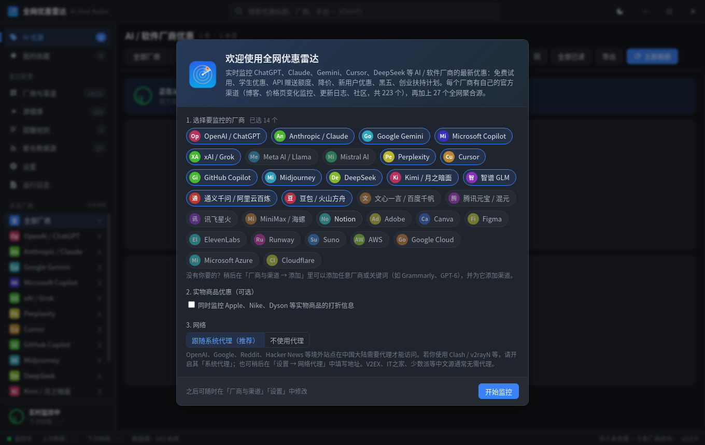
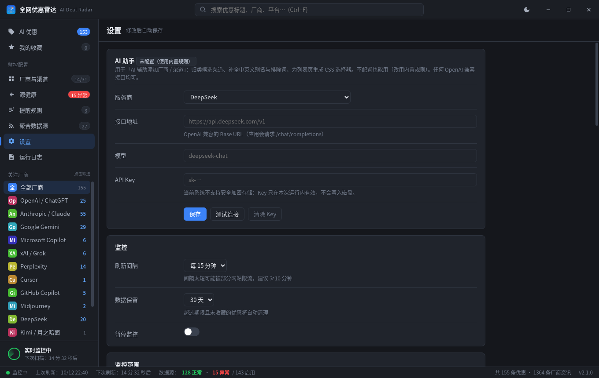

# 全网优惠雷达

**2.9.0** · 实时监控 ChatGPT、Claude、Gemini、Cursor、DeepSeek 等 AI / 软件厂商优惠的 Windows 桌面应用，也可选监控实物品牌折扣。

## 界面截图



*欢迎页 / Welcome screen*


*优惠卡片（深色） / Deal cards, dark theme*


*厂商与品牌 / Vendors and brands*



*设置 / Settings*

## 功能特性

- 多渠道采集：官方博客、价格页、更新日志、YouTube、GitHub、社区，以及新闻 / HN / Reddit 等聚合源。
- 自动识别试用、折扣、赠送额度、学生与创业计划、限时活动、价格页变动；发现优惠时桌面通知。
- 可筛选厂商与类型、搜索、卡片 / 表格视图、收藏与导出 CSV；支持自定义厂商和渠道。
- 实物商品监控为可选项，默认关闭。

## 技术栈

- Electron
- JavaScript
- HTML 解析与 RSS/XML（fast-xml-parser、node-html-parser）

## 从源码运行

源码在仓库根目录。本仓库不包含安装包。

```bash
npm install
npm start            # Electron
npm test
```
数据保存在本机用户目录。更完整的使用说明见 `README.original.md`（其中若提到安装包，以本仓库实际文件为准：只提供源码）。

## 文档

- [使用说明](README.original.md)

---

## English

# Deal Radar

**2.9.0** · A Windows desktop app that watches deals from AI and software vendors such as ChatGPT, Claude, Gemini, Cursor, and DeepSeek, with optional physical-brand discount monitoring.

## Screenshots


*欢迎页 / Welcome screen*


*优惠卡片（深色） / Deal cards, dark theme*


*厂商与品牌 / Vendors and brands*


*设置 / Settings*

## Features

- Multi-channel intake: official blogs, pricing pages, changelogs, YouTube, GitHub, forums, plus news / HN / Reddit aggregators.
- Classifies trials, discounts, credits, student and startup programs, limited-time offers, and pricing-page changes; desktop notifications on new deals.
- Filter by vendor and type, search, card/table views, favorites, and CSV export; custom vendors and channels are supported.
- Physical-goods monitoring is optional and off by default.

## Tech stack

- Electron
- JavaScript
- HTML 解析与 RSS/XML（fast-xml-parser、node-html-parser）

## Getting started

Source is at the repository root. This repository does not include installers.

```bash
npm install
npm start            # Electron
npm test
```
Data stays in the local user directory. The in-tree `README.original.md` has a longer user guide; ignore installer paths that are not present in this repository.

## Documentation

- [使用说明](README.original.md)

