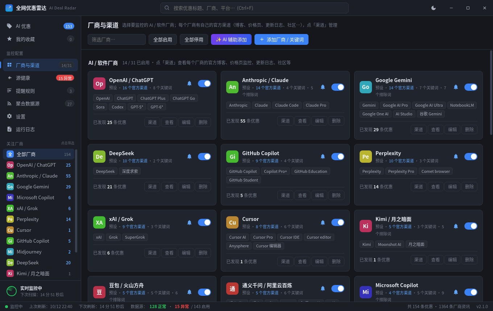

# 全网优惠雷达（Deal Radar）

**2.11.0** · 实时监控 ChatGPT、Claude、Gemini、Cursor、DeepSeek 等 AI / 软件厂商优惠的 Windows 桌面应用，也可选监控实物品牌折扣。

中文 · [English](README.en.md)

## 下载

当前源码版本是 **2.11.0**。已发布的 Windows 安装包仍是 [v2.9.0](https://github.com/gatesenman/deal-radar/releases/tag/v2.9.0)（后续版本会再附安装包）：

- Windows 安装包：`DealRadar-Setup-2.9.0-x64.exe`
- 源码包：`DealRadar-2.9.0-source.zip`

SHA256：

```
d7464de239301fd03b64af8350c5c4904b1f41b2b002f3be806873e66b7cbee4  DealRadar-Setup-2.9.0-x64.exe
9e8749b5b0538547ab8e1c36ddf363c998c396cdb2cc291045daea00f3ef8ff5  DealRadar-2.9.0-source.zip
```

应用没有数字签名。Windows SmartScreen 可能提示「已保护你的电脑」，点「更多信息 → 仍要运行」即可。从旧版本升级会保留本机优惠数据和设置。

也可以从源码运行，或自行执行 `npm run dist:win` 打包。

## 界面截图

以下为仓库 `screenshots/` 中已有的真实产品界面。


*欢迎页 / Welcome screen*


*优惠卡片（深色） / Deal cards, dark theme*



*厂商与品牌 / Vendors and brands*


*设置 / Settings*

## 功能特性（2.11.0）

- **复查更准**：落地页软 404 与更多「已结束」用语；截止日期支持数字日期和「还有 N 天」；价格识别 USD 20 / month 等写法。
- **网址识别协议**：添加渠道时粘贴官方网址即可自动选好 RSS、GitHub、价格页等协议；点「识别」仍可发现页面上的官方订阅源。
- **多渠道采集**：每个厂商走官方博客、价格页、更新日志、状态页、YouTube、GitHub Releases、社区论坛等，再加上新闻 / Hacker News / Reddit 等聚合源。只使用主流官方或地区媒体渠道，不加小众源。
- **默认证件**：AI 厂商默认开启，其它软件和实物品牌默认关闭，可在欢迎页或设置里改。
- **识别与提醒**：自动识别试用、折扣、赠送额度、学生与创业计划、限时活动、价格页变动；发现新优惠时桌面通知，也可推到手机。
- **中英界面**：简体中文 / English，首次按系统语言，设置里可随时切换；厂商使用真实品牌 logo。
- **还能不能领**：优惠状态分为进行中 / 即将截止 / 已过期 / 未知；可复查落地页；列表可隐藏已过期。
- **适用于我**：个人画像（地区、学生、新/老用户、支付方式）+「只看适用于我」筛选，重启后保留。
- **厂商速查与领取指南**：按中文名或别名查询某家当前优惠和官方价格；详情提供领取步骤、官方链接和优惠码复制。
- **覆盖透明度**：按厂商查看上次检查时间、用了哪些源、失败原因，以及免登录条件下覆盖不到的渠道。
- **价格页**：结构化套餐价格、人民币换算、价格历史；只有金额或套餐变化才提醒，减少误报。
- **去重与可信度**：MinHash 近重复合并、多源佐证、来源可靠度；同一站点转帖不算独立来源。
- **省流量轮询**：ETag / Last-Modified 缓存（重启后仍有效）、自适应间隔与抖动，避免同一轮打满请求。
- **推送渠道**：企业微信、飞书、钉钉、Telegram、Server酱、ntfy、通用 Webhook。密钥只存在本机。支持每日 / 每周摘要、保存的视图提醒、试用到期提醒。
- **其它**：上手预设（学生 / 开发者 / 国内用户等）、分享卡片（Markdown / 图片）、筛选与搜索、卡片/表格视图、收藏与 CSV 导出、自定义厂商和渠道。

覆盖率：在「只用主流、免登录来源」的约束下，实测大约 85%（详见 [SOURCE_COVERAGE.md](SOURCE_COVERAGE.md)）。登录墙、运营商活动页和部分帮助中心无法在不登录的前提下覆盖到 99%。

## 从源码运行

源码在仓库根目录。需要 Node.js 和 npm。

```bash
npm install
npm start            # Electron
npm test
npm run dist:win     # 打包 Windows 安装包与便携版（需要相应环境）
```

数据保存在本机用户目录（Windows 上为 `%APPDATA%\全网优惠雷达\`），升级不会清空。

## 技术栈

Electron · JavaScript · HTML 解析与 RSS/XML（`fast-xml-parser`、`node-html-parser`）

更完整的版本记录见 [CHANGELOG.md](CHANGELOG.md)，设计说明见 [DESIGN.md](DESIGN.md)，调研笔记见 [RESEARCH.md](RESEARCH.md)。

## 贡献

欢迎通过 Issue 和 Pull Request 参与，详见 [CONTRIBUTING.md](CONTRIBUTING.md)。安全问题请按 [SECURITY.md](SECURITY.md) 私下报告。参与时请遵守 [CODE_OF_CONDUCT.md](CODE_OF_CONDUCT.md)。

## 许可证

[MIT](LICENSE)

---

## English

# Deal Radar

**2.11.0** · A Windows desktop app that watches deals from AI and software vendors such as ChatGPT, Claude, Gemini, Cursor, and DeepSeek, with optional physical-brand discount monitoring.

Chinese above · [standalone English guide](README.en.md)

## Download

The source tree is **2.11.0**. The published Windows installer is still [v2.9.0](https://github.com/gatesenman/deal-radar/releases/tag/v2.9.0); a newer installer will ship in a later release:

- Windows installer: `DealRadar-Setup-2.9.0-x64.exe`
- Source zip: `DealRadar-2.9.0-source.zip`

SHA256:

```
d7464de239301fd03b64af8350c5c4904b1f41b2b002f3be806873e66b7cbee4  DealRadar-Setup-2.9.0-x64.exe
9e8749b5b0538547ab8e1c36ddf363c998c396cdb2cc291045daea00f3ef8ff5  DealRadar-2.9.0-source.zip
```

The app is not code-signed. If Windows SmartScreen shows “Windows protected your PC”, choose “More info → Run anyway”. Upgrades keep your local deals and settings.

You can also run from source, or package with `npm run dist:win`.

## Features (2.11.0)

- Paste an official URL when adding a channel to auto-detect RSS, GitHub, pricing pages, and other protocols.
- Multi-channel intake from official blogs, pricing pages, changelogs, status pages, YouTube, GitHub, and forums, plus news / HN / Reddit aggregators. Mainstream official and regional sources only.
- AI vendors are on by default; other software and physical brands are off until you enable them.
- Classifies trials, discounts, credits, student and startup programs, limited-time offers, and pricing-page changes. Desktop notifications, with optional phone push.
- Simplified Chinese / English UI, real brand logos, and persistent “applies to me” filters.
- Offer validity (active / ending soon / expired / unknown), vendor lookup, claim guides, and a coverage-transparency page.
- Structured pricing with CNY conversion and history; fewer false page-change alerts.
- MinHash dedup, corroboration-based confidence, persistent HTTP cache, and adaptive polling with jitter.
- Push channels: WeCom, Feishu, DingTalk, Telegram, Server酱, ntfy, and generic webhooks. Keys stay on the device. Daily / weekly digests, saved-view alerts, trial reminders, share cards, and onboarding presets.

Measured coverage is about 85% of real mainstream deals without logged-in sources. See [SOURCE_COVERAGE.md](SOURCE_COVERAGE.md). 99% is not reachable without logins or in-app sources.

## Getting started

```bash
npm install
npm start
npm test
```

Data lives in the local user directory (`%APPDATA%\全网优惠雷达\` on Windows) and survives upgrades.

## License

[MIT](LICENSE)
