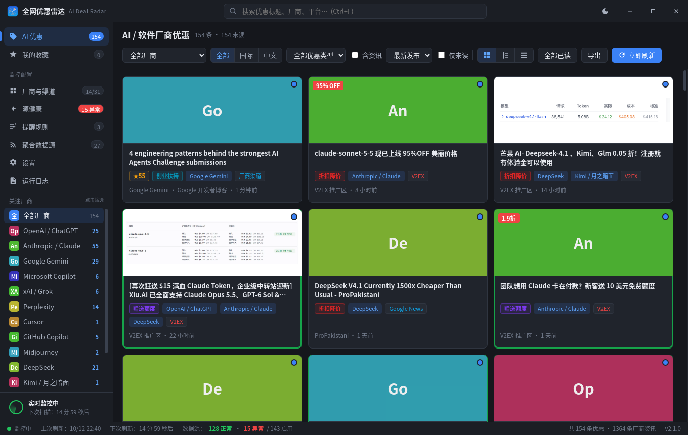

# 全网优惠雷达

**2.9.0** · 实时监控 ChatGPT、Claude、Gemini、Cursor、DeepSeek 等 AI / 软件厂商优惠的 Windows 桌面应用，也可选监控实物品牌折扣。

## 下载

当前 GitHub 上**没有**已发布安装包（无 Release）。`package.json` 版本为 **2.9.0**，打包命令 `npm run dist:win`。请忽略旧文档中的 `DealRadar-Setup-2.5.0-x64.exe` 等文件名，发行页上并不存在这些资产。本轮因磁盘不足未打包上传。

## 界面截图

以下为仓库 `screenshots/` 中已有的真实产品界面，不是生成图。


*欢迎页 / Welcome screen*



*优惠卡片（深色） / Deal cards, dark theme*


*厂商与品牌 / Vendors and brands*


*设置 / Settings*

## 功能特性

- 多渠道采集：官方博客、价格页、更新日志、YouTube、GitHub、社区，以及新闻 / HN / Reddit 等聚合源。
- 自动识别试用、折扣、赠送额度、学生与创业计划、限时活动、价格页变动；发现优惠时桌面通知。
- 可筛选厂商与类型、搜索、卡片 / 表格视图、收藏与导出 CSV；支持自定义厂商和渠道。
- 实物商品监控为可选项，默认关闭。

## 技术栈

- Electron
- JavaScript
- HTML 解析与 RSS/XML（fast-xml-parser、node-html-parser）

## 从源码运行

源码在仓库根目录。当前没有已发布安装包（见上方「下载」）。

```bash
npm install
npm start            # Electron
npm test
```
数据保存在本机用户目录。本仓库只提供源码；请忽略旧文档中可能出现、但本仓库并不包含的安装包路径。

## 文档
- [English](README.en.md)

## 贡献

欢迎通过 Issue 和 Pull Request 参与，详见 [CONTRIBUTING.md](CONTRIBUTING.md)。安全问题请按 [SECURITY.md](SECURITY.md) 私下报告。参与时请遵守 [CODE_OF_CONDUCT.md](CODE_OF_CONDUCT.md)。

## 许可证

本仓库尚未附带 LICENSE 文件，许可证未指定。

---

## English

# Deal Radar

**2.9.0** · A Windows desktop app that watches deals from AI and software vendors such as ChatGPT, Claude, Gemini, Cursor, and DeepSeek, with optional physical-brand discount monitoring.

## Screenshots


*欢迎页 / Welcome screen*


*优惠卡片（深色） / Deal cards, dark theme*


*厂商与品牌 / Vendors and brands*


*设置 / Settings*

## Features

- Multi-channel intake: official blogs, pricing pages, changelogs, YouTube, GitHub, forums, plus news / HN / Reddit aggregators.
- Classifies trials, discounts, credits, student and startup programs, limited-time offers, and pricing-page changes; desktop notifications on new deals.
- Filter by vendor and type, search, card/table views, favorites, and CSV export; custom vendors and channels are supported.
- Physical-goods monitoring is optional and off by default.

## Tech stack

- Electron
- JavaScript
- HTML 解析与 RSS/XML（fast-xml-parser、node-html-parser）

## Download

There is **no** published installer on GitHub Releases. The app version is **2.9.0**. Package with `npm run dist:win`. Ignore older filenames such as `DealRadar-Setup-2.5.0-x64.exe`; they are not release assets. This pass did not build or upload packages (disk).

## Getting started

Source is at the repository root. There is no published installer yet (see Download above).

```bash
npm install
npm start            # Electron
npm test
```
Data stays in the local user directory. This repository ships source only; ignore installer paths from older notes that are not present here.

## Documentation

- [English](README.en.md)

## Contributing

Issues and pull requests are welcome. See [CONTRIBUTING.md](CONTRIBUTING.md). Please report vulnerabilities privately via [SECURITY.md](SECURITY.md). This project follows [CODE_OF_CONDUCT.md](CODE_OF_CONDUCT.md).

## License

No LICENSE file is included in this repository; the license is unspecified.
